# Tradewind TW-1 · solar LoRaWAN field sensor

<p align="center">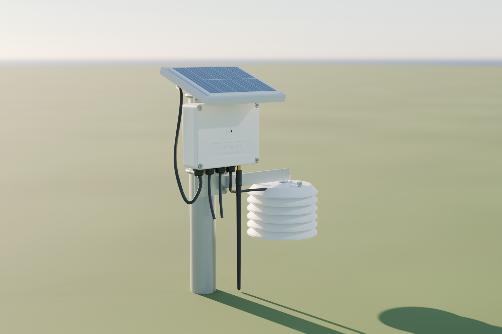</p>

Tradewind is a sealed, solar-powered sensor for farms and remote sites. It measures air temperature and humidity,
soil moisture and rainfall, and reports over LoRaWAN every 5 minutes (every minute in rapid mode). It is a complete
reference design by [Binary Beach](https://binarybeach.tech): requirements, simulation, schematic, a 4-layer board,
enclosure, firmware, bring-up, characterization and a 30-day field pilot.

**The full story is in the documents. This README is a map of the repository.**

| | |
|---|---|
| 📘 [Engineering design & test report](docs/Tradewind_TW-1_Engineering_Report_revB.pdf) (46 pages) | requirements, simulation, schematic, electrical and layout considerations, EMI/EMC, enclosure, bring-up, test and field data |
| 📗 [Product datasheet](docs/Tradewind_TW-1_Datasheet_revB.pdf) (14 pages) | specifications, typical characteristics, connector functions, drawings, ordering |
| 🌐 [Interactive page](https://binarybeach.tech/hardware/tradewind/) | the product and the board in 3D, the schematic and the PCB layers in the browser |

## Results at a glance (rev B)

| | Measured | Requirement |
|---|---|---|
| Sleep current, whole device | 7.2 µA mean, 8.1 µA max (10 boards) | ≤ 10 µA |
| Average current, 5-min SF9 | 75.9 µA | ≤ 100 µA |
| Days with no sun at all, 1-min mode | ≈ 250 | ≥ 60 |
| Radio range, line of sight | decoded at 13.2 km (SF10) | ≥ 5 km |
| Air temperature error, −10 to +60 °C | 0.20 °C worst | ±0.3 °C |
| Hottest cell, 30 days in Hawaiʻi sun | 37.1 °C (air 31.9 °C) | < 45 °C |
| Uplinks received, 3 units × 30 days | 99.3 % | – |
| Electronics cost at 1,000 units | $16.43 (parts, PCB, assembly) | ≤ $25 |

13 of 15 requirements pass outright, R6 (charge window) passes marginally, and R10 (IP66 jet) is open pending an
accredited lab. See `test/compliance.csv`.

> Bench and field figures in this release are representative values for the reference design. The analysis scripts in
> `test/` run unchanged on new logs.

<p align="center">
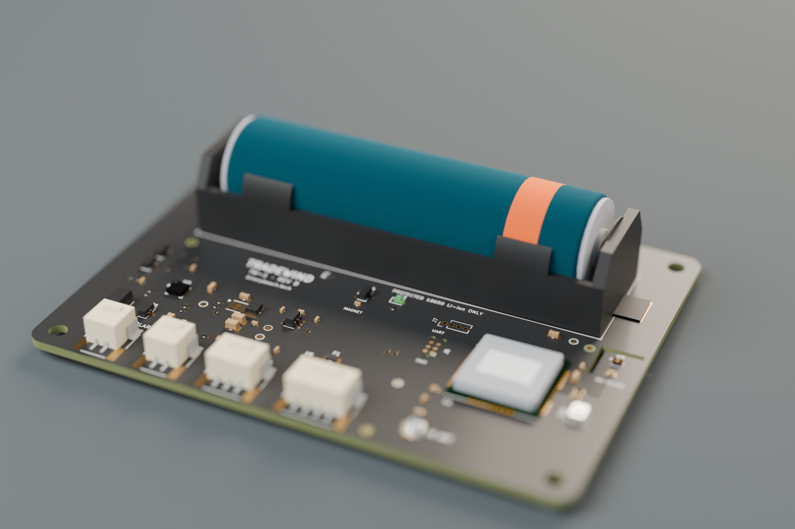
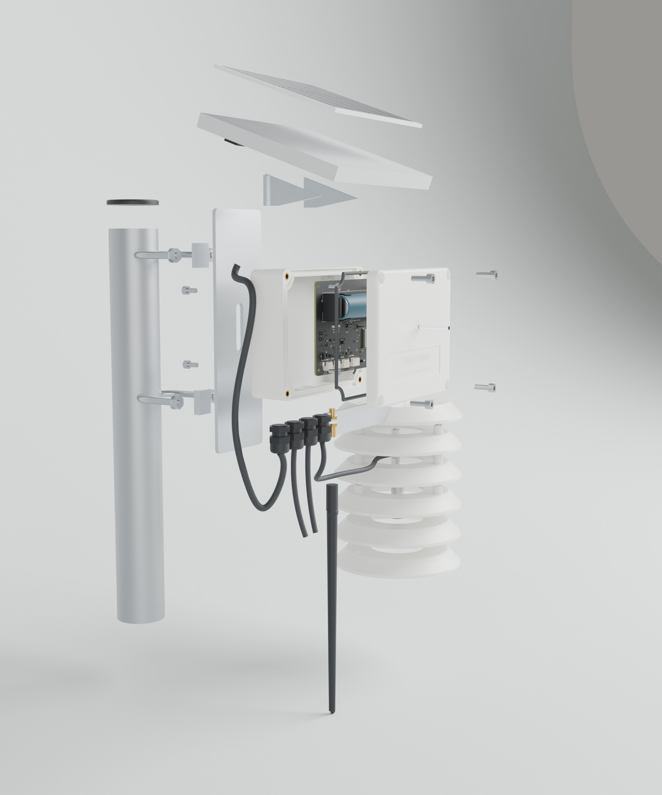
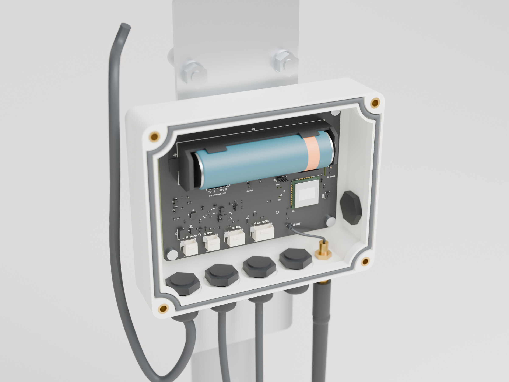
</p>

## How the design flows

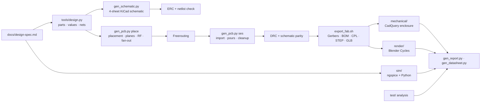

The schematic and the board are generated from one design file, `tools/design.py`, so they can't drift apart.
`tools/check_netlist.py` checks KiCad's exported netlist against that file pin by pin (233 pins, 47 nets), and DRC runs with schematic parity.
The KiCad project is an ordinary KiCad 9 project, so you can open it and edit it by hand.

## Repository walkthrough

```
docs/         design spec, report + datasheet (HTML sources and PDFs), figures, schematic PDF/SVG
hardware/     KiCad 9 project (tradewind/) and fabrication outputs (fab/)
mechanical/   CadQuery enclosure system: sources, STEP/STL/GLB, drawings, mechanical BOM
firmware/     RAK3172 / RUI3 firmware, payload codec, network-server decoder, host tests
sim/          10 simulations (ngspice decks + Python models) and their results
test/         test logs (CSV), analysis scripts, compliance table, bring-up log
render/       Blender render script and the renders
tools/        generators: schematic, PCB, 3D models, BOM, fab export, layout audit, docs, plot style
```

### `hardware/`: schematic and board
- `tradewind/tradewind.kicad_pro`: open this in KiCad 9. Root sheet plus `power`, `mcu_rf` and `sensors_io` sheets; `tradewind.kicad_pcb` is the routed board.
- `tradewind/tradewind.kicad_sym`: project symbol (DRV5032 hall switch). `tradewind/3d/` holds the 3D models we made because the library has none (RAK3172, JST PH side-entry, VQFN-16, SHT4x, 18650 cell).
- `fab/`: `tradewind_revB_gerbers.zip` (11 Gerber X2 layers plus drill), `assembly/tradewind_revB_cpl.csv`, `BOM_tradewind_revB.csv` (costed at 10/100/1k), `BOM_JLCPCB.csv`, the board as STEP and GLB, per-layer SVGs, `erc_report.txt` and `drc_report.txt`.
- Board: 96 × 70 mm, 4 layers (JLC 7628 stackup), matte black ENIG, 85 footprints, 50 Ω CPWG RF line, SHT40 on a slotted thermal island.
- `tools/layout_audit.py` measures the routed board (copper per net, current-path resistance, hot-loop areas, separations, RF geometry) into `fab/layout_audit.json`;
  `tools/layout_figs.py` draws the layout figures from it: each part outline comes from that part's pads, and numbered markers sit on computed features. The report's section 4 (electrical, BOM, layout, EMI/EMC) is built on those numbers.

<p align="center">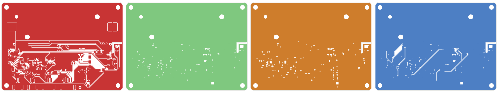</p>

### `sim/`: design analysis
Run `sim/run_all.sh` (about 20 s). It regenerates every `docs/figures/sim_*` figure and `sim/results.json`.

| Script | Question it answers |
|---|---|
| `solar_iv.py` | Does the charger's fixed 4.5 V input regulation get enough of the panel's power? (96–99 %) |
| `thermal_enclosure.py` | How hot does the cell get in the sun, and does the roof fix it? |
| `energy_year.py` | Is the device energy-positive for a whole Honolulu year, including an overcast week? |
| `power_budget.py` | Where does each uplink's charge go? What's the average current per mode? |
| `tx_droop.py` | Does +3V3 stay in spec during the 87 mA transmit burst? |
| `vbat_sense.py` | Why did rev A sleep at 34 µA? (battery divider leaking into the ADC clamp) |
| `rain_debounce.py` | Why did rev A double-count rain? (reed bounce) |
| `rf_match.py` | Antenna match in the closed case; 50 Ω trace geometry |
| `link_budget.py` | Range per spreading factor, and airtime |
| `board_si.py` | On the routed board: power-path drop, I²C over the probe cable, harmonic filtering, ADC settling |

<p align="center">
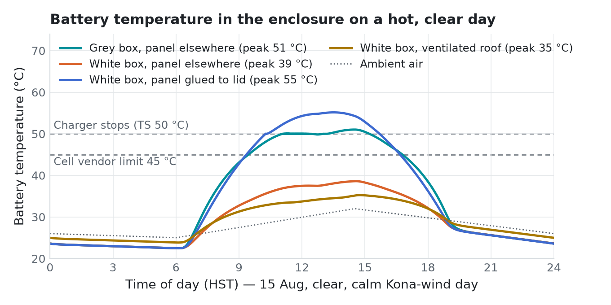
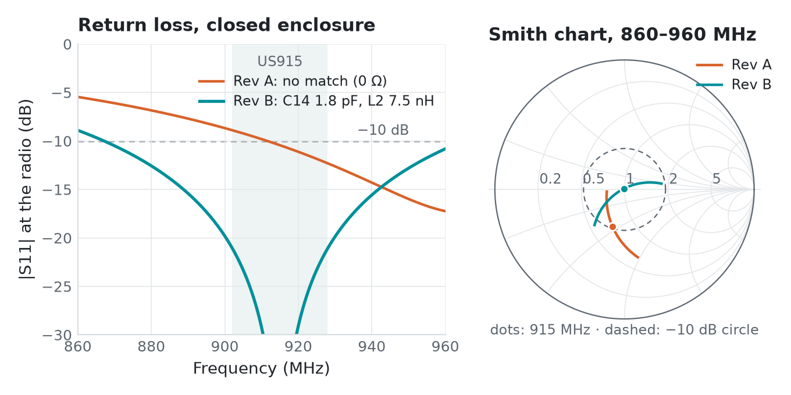
</p>

### `mechanical/`: enclosure
`src/assembly.py` builds the whole system (box, lid, gasket, sun roof with panel, radiation shield, bracket, glands,
antenna) from parametric CadQuery parts. It checks fit against the board STEP and exports `out/tradewind_assembly.step`,
print-ready STLs and web GLBs. Materials, sealing math, print settings and the assembly order are in `mechanical/README.md`.

### `firmware/`: RAK3172 (STM32WLE5) on RUI3
Class A OTAA, US915 sub-band 2. Default interval 5 min, with a rapid 1-minute mode. Rain counting and magnet wake work while asleep.
`make test` runs the C++ payload tests and the JavaScript decoder tests against shared golden vectors.
The payload format is in `firmware/PAYLOAD.md`. The decoder for The Things Stack and ChirpStack is `firmware/decoder/ttn_decoder.js`.

### `test/`: characterization
`test/run_all.sh` turns the CSV logs in `test/data/` into every `docs/figures/test_*` figure, `results.json` and
`compliance.csv`. The test plan with pass criteria is `test/README.md`. The step-by-step bring-up (and the two rev A bugs) is in `test/BRINGUP.md`.

<p align="center">
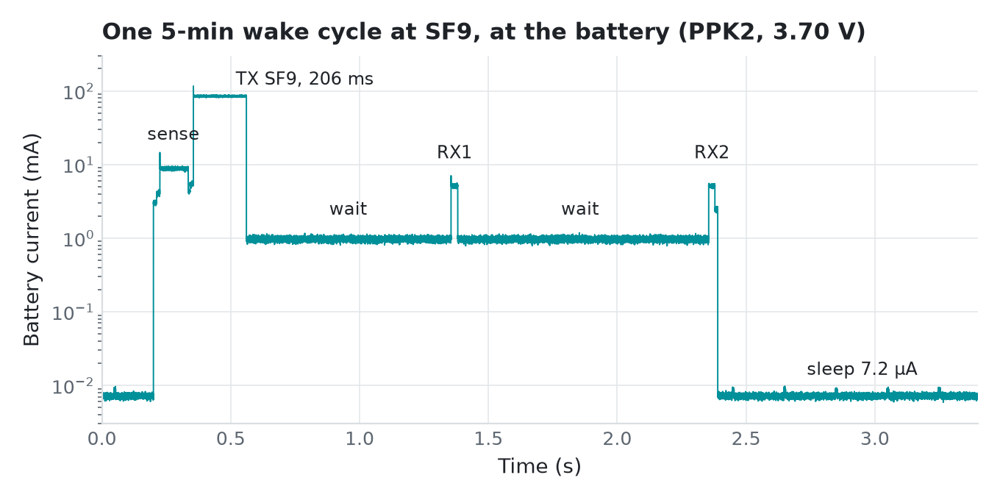
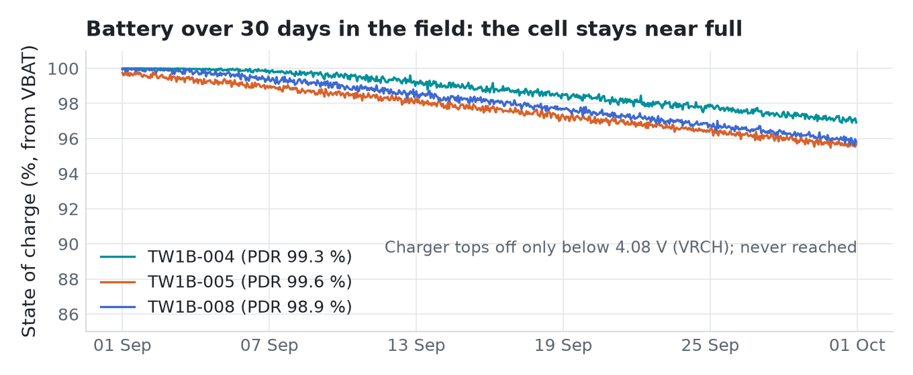
</p>
<p align="center">
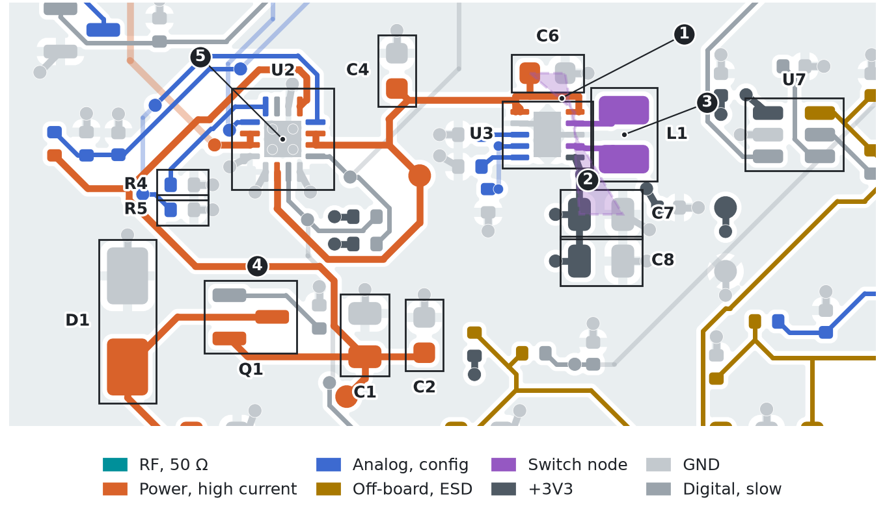
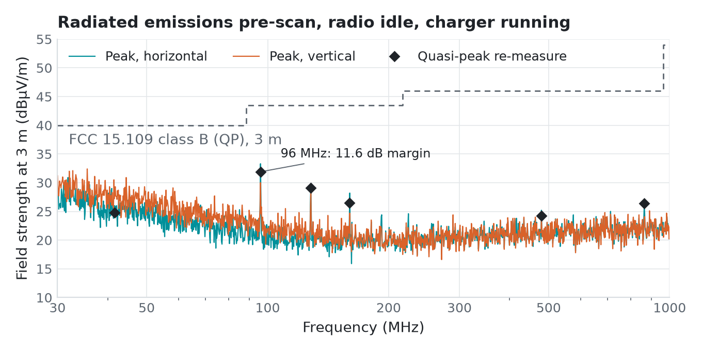
</p>

### `render/` and `docs/`
- `render/scripts/render.py`: Blender Cycles shots from the CAD and board exports (studio, outdoor, exploded, lid off, board, turntable).
- `tools/gen_report.py` and `tools/gen_datasheet.py` build `docs/report/` and `docs/datasheet/`. Every number comes from the result files, through `tools/docdata.py`.
- `tools/paginate.py` lays the report out in headless Chrome: each chapter flows across Letter pages, a heading never ends a page,
  and a full-width chart is never squeezed into half a column.
- `tools/build_docs.py --pdf` collects the images and prints both PDFs. `tools/check_pages.py` fails a page if its content overflows the Letter sheet.

## Rebuilding everything

| Tool | Used for |
|---|---|
| KiCad 9 (`snap install kicad`) | schematic, board, `kicad-cli` exports |
| Freerouting 1.9 + Java 21 | autorouting (run headless with `xvfb-run`) |
| conda env `environment.yml` | ngspice, CadQuery, numpy/scipy/matplotlib |
| Blender 4.2+ | renders |
| Google Chrome | PDF printing and page checks |

```bash
python3 tools/gen_schematic.py                                   # schematic from tools/design.py
snap run --shell kicad.kicad-cli -c "python3 tools/gen_pcb.py place && python3 tools/gen_pcb.py dsn"
(cd hardware/tradewind && xvfb-run -a java -jar freerouting-1.9.0.jar -de tradewind.dsn -do tradewind.ses -mp 40)
snap run --shell kicad.kicad-cli -c "python3 tools/gen_pcb.py ses"   # import routes, pour ground, clean up
tools/export_fab.sh                                              # ERC, DRC, Gerbers, BOM, CPL, STEP, GLB, renders, layout audit
sim/run_all.sh && test/run_all.sh                                # simulations and test analysis
python mechanical/src/assembly.py                                # enclosure (conda env)
blender -b --python render/scripts/render.py                     # renders
python3 tools/build_docs.py && (cd tools && python3 gen_report.py && python3 gen_datasheet.py) && python3 tools/build_docs.py --pdf
```

## License
Hardware (`hardware/`, `mechanical/`): [CERN-OHL-P-2.0](LICENSE-HARDWARE). Firmware, simulations and tools: [MIT](LICENSE).
Documentation, figures and renders: [CC BY 4.0](LICENSE-DOCS). Component datasheets belong to their manufacturers and are not included.

Designed by Maxwell Pauly · Binary Beach LLC · Honolulu, Hawaiʻi · maxwell.pauly@binarybeach.tech
