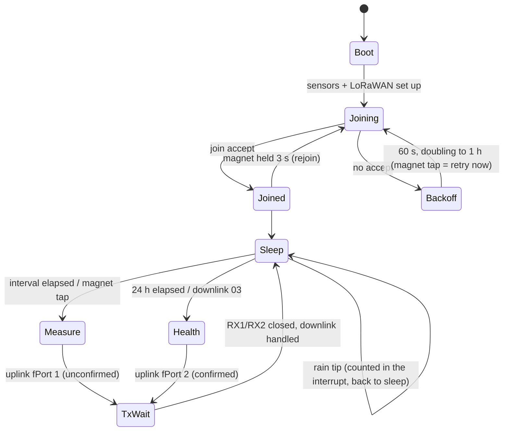

# Tradewind TW-1 firmware

Firmware for the RAK3172 (STM32WLE5 + LoRa radio) on the Tradewind board, written against
RAKwireless **RUI3 v4.x** (Arduino-style API). It wakes, reads the sensors, sends one small
LoRaWAN uplink, and goes back to sleep. Pin map, power numbers and requirements come from
[`../docs/design-spec.md`](../docs/design-spec.md).

> **Status:** the payload packer, downlink parser, CRC and network-server decoder are unit-tested
> on a PC (`make test`). The sketch compiles against stand-in RUI3 headers (`make check`), which
> catches typos and type errors only. `arduino-cli` and the RUI3 core were not installed on the
> machine this was written on, so it has **not** been built with the real RUI3 core yet. Do that
> first at bring-up (below).

## Layout

| File | What it does |
|---|---|
| `tradewind/tradewind.ino` | Main loop: join, scheduler, uplinks, downlinks, sleep |
| `tradewind/board.h` | Pin map and analog scaling (rev B board) |
| `tradewind/config.h` | Intervals, rapid-mode triggers, battery thresholds, soil calibration |
| `tradewind/sensors.*` | SHT40/SHT45 (CRC-checked), soil probe behind the load switch, VBAT through the high-side switch, panel voltage, charger status |
| `tradewind/inputs.*` | Rain-gauge counter (interrupt, counts while asleep), magnet tap/hold on the lid, LED patterns |
| `tradewind/payload.*` | Uplink packer and downlink parser. Plain C++, shared with the host test |
| `tradewind/secrets.h.example` | Copy to `secrets.h` (git-ignored) and add your keys |
| `decoder/ttn_decoder.js` | `decodeUplink` / `encodeDownlink` for The Things Stack and ChirpStack v4 |
| `PAYLOAD.md` | Byte-by-byte format |
| `test/` | Golden vectors (hand-worked), C++ test, RUI3 stubs |

## How it runs



- **Scheduler.** One cooperative `loop()`. It works out the next deadline (uplink, health or join retry)
  and calls `api.system.sleep.all(ms)`. The rain gauge and the hall switch interrupts wake it early.
  All timing uses `millis()`, which RUI3 keeps counting through sleep.
- **Rapid mode.** The interval drops from 5 min to 1 min for 60 min when soil moisture moves ≥ 3 %
  between uplinks, when ≥ 5 tips (1 mm) fell since the last uplink, or by downlink `02 MM`.
  It is refused below 3.30 V.
- **Rain.** Falling edge on PA0. The RC network on the board (1 MΩ / 10 kΩ / 22 nF) already turns reed
  bounce into one edge (see `sim/`). A 50 ms software lockout is the second line of defense. The
  counter is cumulative, so a lost uplink loses no rain.
- **Magnet.** Tap the lid logo with a magnet: the LED blinks once and the unit sends now (or retries the
  join). Hold it 3 s and remove it: the unit drops its session and joins again.
- **Battery.** Below 3.30 V the battery-low flag is set and rapid mode is refused. Below 3.10 V only the
  daily health frame goes out. The protected cell's own PCM cuts off at 2.5 V.

LED: 2 quick blinks = joining, 3 blinks = joined, 1 short blink = magnet seen, 1 long = join failed.
The LED is off at all other times (it costs ~0.5 mA when on).

## One uplink, step by step (5-min interval, SF9)

| Step | Time | Current at 3.3 V | Notes |
|---|---|---|---|
| Sleep (STOP2, RTC on) | ~297 s | 6.9 µA whole board, at the battery | charger 4.3 µA is the biggest part |
| Wake, read SHT45 + SHT40 | ~20 ms | ~4 mA | 8.3 ms per conversion |
| Soil probe on (load switch) | 100 ms warm-up + read | ~9 mA | probe ~5 mA |
| VBAT divider on | 3 ms | ~4 mA | settles in 2.5 ms (5 τ) |
| TX, 24-byte frame, +20 dBm | 206 ms | 87 mA | 62 ms at SF7 |
| Wait for RX1 / RX2 | ~2 s | ~1 mA | `tx_busy`: light idle, no deep sleep |
| RX windows | 2 × 25 ms | 5.2 mA | |

About 21.5 mC per uplink at 3.3 V, so ≈ 78 µA average at the battery at 5 min and ≈ 365 µA at 1 min
(design spec §5). Check these numbers with a power profiler at bring-up, at the TP3 (VBAT) test point.

## Build and flash

1. Install the RAK RUI3 board package in the Arduino IDE or arduino-cli (board manager URL:
   `https://raw.githubusercontent.com/RAKWireless/RAKwireless-Arduino-BSP-Index/main/package_rakwireless.com_rui_index.json`).
2. `cp tradewind/secrets.h.example tradewind/secrets.h` and fill in DevEUI, JoinEUI and AppKey from your
   network server. **Never commit `secrets.h`** (it is in `.gitignore`).
3. Build:
   ```sh
   arduino-cli core install rak_rui:stm32
   arduino-cli compile --fqbn rak_rui:stm32:WisDuoRAK3172EvaluationBoard tradewind
   ```
4. Flash, either way:
   - **UART2 (J7 pads, PA2/PA3).** RUI3's bootloader takes the image over UART:
     `arduino-cli upload --fqbn rak_rui:stm32:WisDuoRAK3172EvaluationBoard -p /dev/ttyUSB0 tradewind`.
     If the application is broken, hold the BOOT0 pad high through a reset (SW1) to force the
     ROM bootloader.
   - **SWD (J6, Tag-Connect TC2030-NL)** with an ST-Link or J-Link: flash the `.hex` from the build
     folder with STM32CubeProgrammer.
5. In the network server, paste `decoder/ttn_decoder.js` as the uplink/downlink formatter.

Region: US915, sub-band 2 (channels 8–15 + 65), ADR on. Change `LORA_SUBBAND_MASK` and the band in
`lora_setup()` for other regions.

## Tests

```sh
make test     # C++ packer + parser vs golden vectors, JS decoder vs the same vectors, sketch syntax check
```

`test/golden_vectors.json` holds hand-worked bytes for typical, negative, clamped and missing-sensor
cases, one health frame, and valid and invalid downlinks. The JS test also packs 2 000 random frames
with a float32 mirror of the C packer and checks every field decodes within half a step.

## Bring-up checklist (firmware side)

- [ ] Builds with the real RUI3 core (v4.x); fix anything the stubs could not catch.
- [ ] `ADC_FULL_SCALE_MV`: measure TP3 with a meter and compare with the reported VBAT; trim if needed.
- [ ] Sleep current at TP3 ≤ 10 µA with the probe connected (spec R2).
- [ ] Rain: 100 tips from a bench reed driver at 2 Hz → counter +100 exactly (spec R15).
- [ ] Magnet: tap → uplink within 2 s; 3 s hold → rejoin.
- [ ] Downlinks `01 00 B4`, `02 0F`, `03`, `04 B0 07` each do what PAYLOAD.md says.
- [ ] Soil calibration: record dry-air and water readings for the probe type, update `SOIL_DRY_MV` / `SOIL_WET_MV`.
