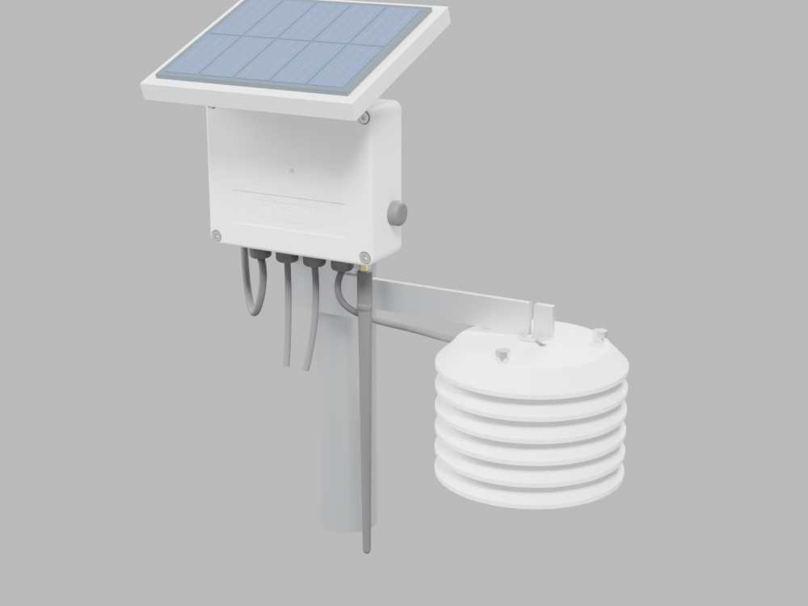

# Tradewind TW-1 — mechanical design

Parametric CadQuery model of the whole installed system: the sealed box, lid, gasket, sun roof with the 2 W
panel, radiation shield, pole bracket and all bought-in hardware. Everything is generated from code in
`src/`; numbers below come from `results.json`, which the build writes.



| | |
|---|---|
| Box (W × H × D) | **122 × 98 × 45 mm** (36 mm body + 6 mm mounting bosses + 3 mm lid top), 3 mm walls, 1° draft |
| Box + roof + panel | 150 × 203 × 121 mm |
| Installed envelope (excl. pole) | 285 × 362 × 149 mm (roof top to antenna tip) |
| Mass | 292 g box unit incl. PCBA and cell · 952 g installed (excl. pole) |
| Internal volume | 327 cm³ gross, 292 cm³ free after the PCBA |
| Sealing | 2.5 mm silicone cord, 26 % squeeze, 78 % groove fill, screws outside the seal line |
| Printed parts | ≈ 8.8 h total on a 0.4 mm nozzle (ASA) |
| Mechanical BOM | $61 / unit at 100 · $34 at 1k (molded box, tooling excluded) |

## How it is oriented

The box hangs vertically on the pole. The PCB stands vertical with its component side facing the lid, the
connector edge down. All cables and the antenna leave through the **bottom** wall, so water runs off them and
never toward a seal. Model frame: x right, y up, z toward the viewer (the lid). The STEP export is rotated to
the usual Z-up installed frame; the GLBs keep y up (glTF), in metres.

## Design decisions

**Material — ASA.** UV-stable outdoors, unlike PLA/PETG/ABS, prints well enclosed, about 95 °C heat
deflection, which covers a box in Hawaiian sun under a roof. Production path: the same geometry in PC/ASA,
molded. Walls are 3 mm with 1° draft on every molded-direction wall, ribs at 0.6 × wall, and corner radii
throughout, so the CAD transfers to tooling with no redesign. A two-cavity box + lid tool is about $9.5k.

**Seal stack-up (IP66 target, IP67 stretch).** The base rim is thickened inward to 6 mm (a 45° chamfer
underneath keeps it printable without supports) and carries a 3.4 × 2.6 mm groove. A 2.5 mm silicone cord
sits in it; the lid has a 1.6 × 0.75 mm tongue and lands hard on the rim, so compression is set by geometry,
not by screw torque:

```
compressed height = groove depth − tongue = 2.60 − 0.75 = 1.85 mm
squeeze           = (2.50 − 1.85) / 2.50   = 26 %   (target 20–30 % for static silicone face seals)
groove fill       = π·1.25² / (3.4 × 1.85) = 78 %   (keep < 85 % so the cord has room to flow)
```

The four M4 lid screws sit in **corner columns outside the seal line**: the groove loops inside each column,
so a screw hole is never a leak path (section B–B). Lid screws go into brass heat-set inserts (6.4 mm thread
engagement) and are held captive by nylon washers, so nobody drops a screw in a field.

**Pressure equalisation.** A sealed box in the sun breathes. Each day it heats up and cools down again, which
pumps humid air through the gasket and leaves condensation inside. A Gore M12 ePTFE vent on the right wall
equalises the pressure through a membrane that blocks liquid water. The internal SHT40 on the board watches
for any moisture that still gets in.

**Thermal: the panel is the sunshade.** The 2 W panel sits on a ventilated ASA roof tilted 20° south (Honolulu
is at 21.3° N), with **25 mm of moving air** between the roof underside and the top of the box at its front
face. The roof overhangs the box sides by 14 mm and its front by 45 mm, so direct beam reaches the box only at
low morning and evening sun. That, plus a white box, is what keeps the 18650 under the cell's 45 °C charging
limit (see `sim/thermal_enclosure.py`). Two 3 mm aluminium gussets carry the roof from the pole bracket. They
don't touch the box, so roof heat can't conduct into it.

**Drip loops.** Every cable leaves a gland downward and loops below it before it turns toward its sensor: the
solar lead runs up the side to the junction box under the roof, and the probe cable runs along the arm to the
shield. Water follows the loop and drips off at its low point instead of wicking into the gland.

**Radiation shield.** It is a cap plus five 120 mm louvre rings with 45° skirts at 14 mm pitch. The skirts
overlap, so there is no straight line from the sky or the ground to the probe, while trade-wind air passes
freely. The rings are white ASA on three M5 stainless rods with spacer tubes. The SHT45 probe hangs in a
printed hub between the second and third rings. The shield sits 150 mm out on an aluminium arm, away from the
warm box and pole.

**Pole mount.** A 3 mm 5052 plate with two M6 U-bolts and V-saddles takes 25–50 mm poles. The box bolts to the
plate with four M4 screws into blind inserts in the back bosses, so nothing passes through the box floor.

**PCB fit.** The board sits on four Ø7 bosses with M3 inserts and gussets. Checked with OCCT distance
queries against the populated board STEP:
- the board is 2.4 mm from the nearest wall or corner column;
- the 18650 is 5.8 mm below the lid;
- the gland lock-nuts are 10.2 mm from the board and the vent nut 6.0 mm;
- no unintended interference between any modelled parts (`results.json → fit`).

## Printing (prototypes)

| Part | Orientation | Settings |
|---|---|---|
| base | floor down, tree supports under the back bosses | ASA, 0.2 mm layers, 4 perimeters, 25 % gyroid, enclosure ≥ 45 °C |
| lid | front face down (label prints crisp) | same; ironing off |
| roof | top face down | 3 perimeters, 20 % infill |
| shield cap / plates | top face down (45° skirts print without support) | 3 perimeters, 15 % infill |
| spacers, probe holder | as exported | 100 % infill |

Heat-set inserts go in at 245 °C with a tapered tip, flush to 0.2 mm proud, then face them with a flat tip.

## Assembly order and torques

1. Inserts: 4 × M4 in the lid columns, 4 × M3 in the PCB bosses, 4 × M4 in the back bosses.
2. Glands, vent and SMA bulkhead in the bottom and side walls. Lapp PG7 body **2.5 N·m**; vent per Gore
   datasheet (≈ 1.2 N·m); SMA nut **0.9 N·m** with its O-ring outside.
3. U.FL pigtail onto J5 (press until it clicks; route it along the bottom wall).
4. PCB onto the bosses with 4 × M3 × 6, **0.4 N·m**. Fit the protected 18650 (observe polarity silkscreen).
5. Plug in the field cables through the glands, leaving 20 mm of slack inside; tighten the gland caps until the
   seal grips (≈ 1.5 N·m).
6. Gasket cord into the groove, joined at the bottom edge (cyanoacrylate + primer). Light pipe into its boss.
7. Lid on, 4 × M4 × 12 captive screws, cross pattern, **1.0 N·m**. The lid lands on the rim, so you can't
   over-compress the cord.
8. Bracket plate to the box: 4 × M4 × 8, **1.2 N·m**. Then gussets, roof and panel (VHB), and the shield arm.
9. On the pole: U-bolts with saddles, **4 N·m** each nut. Panel faces south. Shape each cable into a drip
   loop and tie it to the bracket.

## Files

| Path | What |
|---|---|
| `src/common.py` | every parameter (dimensions, materials, positions) and shared geometry helpers |
| `src/base.py`, `lid.py`, `roof.py`, `shield.py`, `bracket.py`, `hardware.py` | one module per part family; each runs standalone |
| `src/assembly.py` | builds everything, runs the fit/interference checks, writes STEP / STL / GLB and `results.json` |
| `src/drawings.py` | dimensioned drawings with hidden-line removal, and true sections → `docs/figures/mech_*` |
| `src/preview_blender.py` | quick Cycles previews of the GLBs → `out/previews/` |
| `out/tradewind_assembly.step` | coloured installed assembly including the PCBA (Z up) |
| `out/stl/` | printed parts, already in print orientation |
| `out/web/assembly.glb`, `exploded.glb`, `enclosure_only.glb` | web viewer models (y up, metres, PBR materials, < 6 MB each) |
| `BOM_mechanical.csv` | mechanical bill of materials with costs at 100 and 1k |
| `results.json` | dimensions, masses, clearances, gasket numbers, volumes, print time, BOM totals |

Rebuild (≈ 1 min):

```
~/miniforge3/envs/hwdesign/bin/python mechanical/src/assembly.py
~/miniforge3/envs/hwdesign/bin/python mechanical/src/drawings.py
blender -b -P mechanical/src/preview_blender.py -- mechanical/out/web/assembly.glb mechanical/out/previews/assembly_front34.png front34
```

`assembly.py` re-exports the board GLB from `hardware/tradewind/tradewind.kicad_pcb` (KiCad 9) on every run,
so the web models pick up routing and silkscreen changes. The fit checks use the board STEP at
`.scratch/tradewind_board_placed.step`; re-export it after any placement change.

## Not yet verified

These are design values from the model. Before calling the enclosure IP66, a printed box still needs a
dunk/spray test, a thermal soak in direct sun, and a check of the gasket-join leak point. Print shrinkage on
the groove and the insert holes should be measured on the first print.
